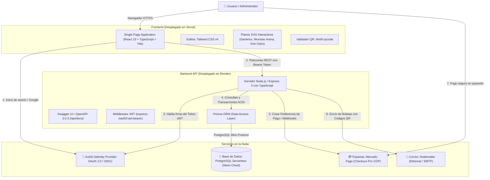

# Mr.Boleta

Tiquetera virtual para eventos musicales. Versión actual: **v0.3.7** (Sprint 3 / Entrega Final).

## Demo en línea

- **Aplicación (Frontend):** https://mr-boleta.vercel.app
- **API (Backend):** https://mr-boleta-api.onrender.com/api/eventos
- **Documentación Swagger / OpenAPI:** https://mr-boleta-api.onrender.com/api/docs
- **Wiki del proyecto:** https://github.com/davidprimo-ctrl/Mr.Boleta/wiki

> **Nota sobre el backend:** El servidor está alojado en el plan gratuito de Render. Si no ha recibido visitas en los últimos 15 minutos, la primera petición puede tardar ~50 segundos mientras el contenedor despierta.

---

## 🏛️ Diagrama de Arquitectura del Software

Arquitectura desacoplada en tres capas con servicios gestionados en la nube:



---

## ✨ Características Principales

- **Documentación interactiva de la API:** Disponible en `/api/docs` (Swagger UI) y especificación OpenAPI en `/api/docs.json`.
- **Panel de administrador (`/admin`):** Gestión de eventos y localidades (crear, editar, publicar y desactivar) con control de roles (`ADMIN` vs `COMPRADOR`).
- **Planos interactivos y recintos preestablecidos:** Visualización SVG interactiva con selección de zonas por localidad, control de aforo y zoom. Soporta:
  - **Recinto genérico:** Autogenerado según las localidades del evento.
  - **Movistar Arena:** Tribuna Fan, Platea 101-106, Piso 2 y Piso 3.
  - **Vive Claro:** LPU PIT 1 y 2, Platea 1 y 2, y sillas 101-132.
- **Reporte de ventas (HU09):** Dashboard en `/admin` con total de ventas aprobadas, ingresos en COP, boletas vendidas y cupos restantes.
- **Check-in con QR:** Validación en tiempo real con la cámara del celular desde `/admin`, con actualización atómica condicional para rechazar boletas usadas o duplicadas.
- **Pagos con Mercado Pago:** Integración con Checkout Pro en COP, retorno seguro y webhook idempotente. Incluye modo `mock` para pruebas locales.
- **Pruebas automáticas:** Suite integral de 66 pruebas automáticas con Jest y Supertest.

Detalle completo de requerimientos y casos de uso en [docs/SPRINT_3.md](docs/SPRINT_3.md).

---

## 💻 Guía de Instalación en un Computador Nuevo

Sigue estos pasos para clonar, configurar y ejecutar el proyecto completo localmente desde cero:

### 1. Prerrequisitos

Asegúrate de tener instalados en tu sistema:
- **Node.js:** Versión 18.0.0 o superior (recomendado **Node.js v20 LTS**).
- **Git:** Para clonar el repositorio.
- **npm:** Gestor de paquetes incluido con Node.js.

Verifica tus versiones ejecutando en la terminal:
```bash
node -v
npm -v
git --version
```

---

### 2. Clonar el Repositorio

Abre una terminal y clona el proyecto:
```bash
git clone https://github.com/davidprimo-ctrl/Mr.Boleta.git
cd Mr.Boleta
```

---

### 3. Configuración del Backend

1. **Entrar al directorio del backend:**
   ```bash
   cd backend
   ```

2. **Instalar dependencias:**
   ```bash
   npm install
   ```

3. **Configurar variables de entorno:**
   Copia el archivo de ejemplo a `.env`:
   ```bash
   # En Windows PowerShell:
   Copy-Item .env.example .env

   # En Linux / macOS / Git Bash:
   cp .env.example .env
   ```

4. **Variables de entorno requeridas en `backend/.env`:**
   Edita `backend/.env` con tus credenciales:
   - `DATABASE_URL`: Cadena de conexión a tu base de datos PostgreSQL (Neon).
   - `AUTH0_DOMAIN`: Dominio de tu aplicación Auth0 (ej. `tu-tenant.us.auth0.com`).
   - `AUTH0_AUDIENCE`: Identificador de la API en Auth0 (ej. `https://api.mrboleta.com`).
   - `PAYMENT_PROVIDER`: Configurar como `mock` (para pruebas locales simuladas) o `mercadopago`.
   - `MP_ACCESS_TOKEN`: Token de prueba de Mercado Pago (si `PAYMENT_PROVIDER=mercadopago`).

5. **Generar el cliente de Prisma:**
   ```bash
   npx prisma generate
   ```

6. **Iniciar el servidor backend en desarrollo:**
   ```bash
   npm run dev
   ```
   El backend iniciará en `http://localhost:3000`.  
   Puedes verificar la documentación interactiva en `http://localhost:3000/api/docs`.

---

### 4. Configuración del Frontend

En **otra pestaña o ventana de la terminal**:

1. **Entrar al directorio del frontend:**
   ```bash
   cd frontend
   ```

2. **Instalar dependencias:**
   ```bash
   npm install
   ```

3. **Configurar variables de entorno:**
   Copia el archivo de ejemplo a `.env`:
   ```bash
   # En Windows PowerShell:
   Copy-Item .env.example .env

   # En Linux / macOS / Git Bash:
   cp .env.example .env
   ```

4. **Variables de entorno requeridas en `frontend/.env`:**
   ```env
   VITE_API_URL=http://localhost:3000/api
   VITE_AUTH0_DOMAIN=tu-tenant.us.auth0.com
   VITE_AUTH0_CLIENT_ID=tu_client_id_de_auth0
   VITE_AUTH0_AUDIENCE=https://api.mrboleta.com
   ```

5. **Iniciar el servidor frontend en desarrollo:**
   ```bash
   npm run dev
   ```
   Abre tu navegador en `http://localhost:5173`.

---

### 5. Ejecutar la Suite de Pruebas Automatizadas

El backend incluye pruebas unitarias y de integración que validan toda la lógica de negocio sin depender de servicios externos:

```bash
cd backend
npm test
```

Para generar el reporte de cobertura de código:
```bash
npm run test:coverage
```
El reporte se generará en la carpeta `backend/coverage/`.
